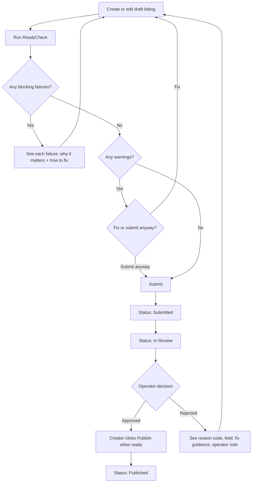
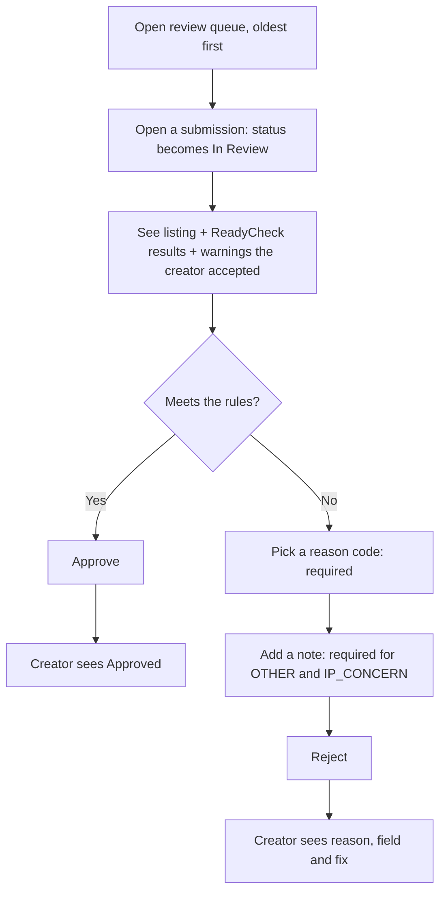
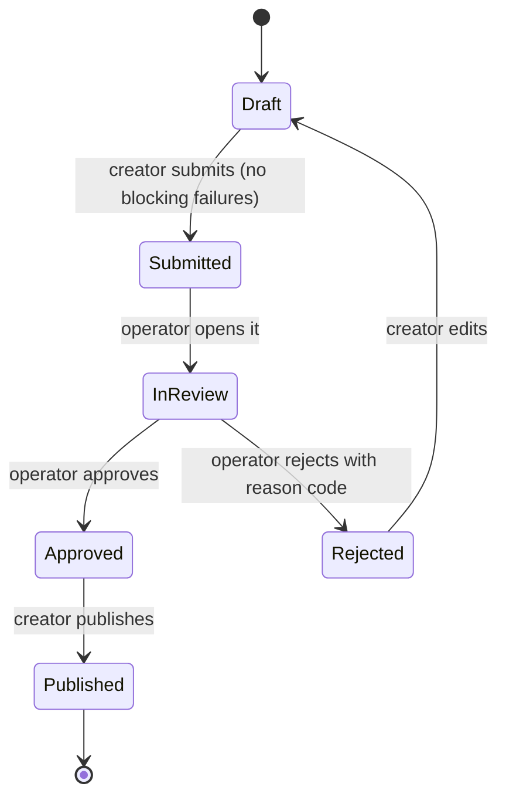

# ReadyCheck: PRD v0.1 (draft for Diego's review)

> **Independent concept project.** Not affiliated with Epic Games and not based on any internal knowledge of
> Epic's tools. The problem framing draws on public creator documentation and public forum posts
> (see [`research/pain_points.md`](../research/pain_points.md)). **All usage numbers in this document are synthetic.**

| | |
|---|---|
| Author | Diego Resendiz |
| Status | Draft: problem statement and priorities still to be rewritten by Diego (Checkpoint 2) |
| Last updated | Oct 22, 2026 |

---

## 1. Problem statement

> ✏️ **DRAFT, Diego to rewrite in his own words.**
>
> Creators publishing an island find out that their listing breaks a rule only after they wait for review,
> and the rejection doesn't always say which field to fix. Each miss costs a full review cycle and
> sometimes several rounds of guess-and-resubmit. Public pre-checks already catch originality problems in
> the title, thumbnail and lobby image. But in public documentation, the rest of the listing (description,
> tags, thumbnail specs, age rating vs. content, version notes) has no check before human review, and no
> single place explains *why* a rule exists and *how to fix* a miss.

## 2. Target users

**Creator: "Sam," solo creator.** Builds Zone Wars and box-fight maps on weekends and has published 3 islands.
Was rejected once for a thumbnail and lost most of a weekend working out why. Wants to know before
submitting whether the listing will pass, and if not, exactly what to change.

**Operator: "Jordan," content review operator.** Works through a queue of submissions each shift. Wants the
oldest submissions first, the listing and its automatic check results on one screen, and a fixed set of
reason codes so two reviewers decide the same case the same way and the creator gets a usable reason.

## 3. Problem sizing (synthetic)

**Sizing metric:** *catchable rejections*. These are first-submission rejections whose reason code maps to a
listing rule that an automatic check could have caught before review (for example, a wrong thumbnail size
or banned terms in the title), as opposed to reasons it can't catch (gameplay issues, IP concerns).

**Why this metric:** it measures exactly the work the feature removes. Every catchable rejection is a review
cycle wasted for both the creator and the operator.

**Synthetic data design.** No public data exists on Fortnite rejection rates, so the seed script generates
~90 days of submissions using these **assumptions**. They are written here so the PRD, data and dashboard agree:

| Assumption (synthetic) | Before ReadyCheck (days 1–45) | After ReadyCheck (days 46–90) |
|---|---|---|
| First-submission approval rate | ~60% | emerges from the next two rows |
| Share of rejections that are catchable | ~60% | — |
| Catchable rejections prevented by the check | — | ~70% (not 100%: warnings can be ignored, attestations can be wrong) |

*Reference point, not a stand-in:* Apple's 2024 App Store report shows roughly 1 in 4 of 7.77M submissions
rejected (press coverage, see research file).

> ⚠️ **Honesty note:** because the data is synthetic, the before/after improvement on the dashboard is
> *designed in*. The dashboard shows that the **measurement works** (queries, charts, metric definitions),
> **not** that the feature works. With real data, sizing would be one query: count first-submission
> rejections by reason code over the last 90 days and take the share that maps to a check.

## 4. Goals and non-goals

**Goals**
1. Creators find and fix listing problems **before** they submit.
2. Every rejection names the **field** and the **fix** (standard reason codes).
3. Operators work the queue **oldest first**, with the check results in front of them.
4. Make it visible **where publishing breaks down** (funnel, top reasons, time to publish).

**Non-goals**
- Replacing human review, or reviewing in-island gameplay (stage 2 of review).
- Analyzing thumbnail images automatically. v1 checks image *metadata* plus creator confirmations.
- Modeling a real age-rating questionnaire. v1 uses generic age tiers.
- Connecting to any real platform.

## 5. User flows

**Creator: submit flow**

**Operator: review flow**

**Status lifecycle**

## 6. Functional requirements

Priority: **M** = Must (v1 fails without it), **S** = Should, **C** = Could.
> ✏️ **Diego to review and change the priorities.** Cut at least one Should or Could, or defend why not.

| ID | Pri | Requirement | Acceptance criteria (Given / When / Then) |
|---|---|---|---|
| FR-1 | M | Creator can create and edit a draft listing: title, description, tags, age rating, version notes, thumbnail metadata (width, height, file size, two confirmations). | **Given** a creator on "New listing", **when** they save with a title, **then** a listing is created with status Draft. **Given** no title, **when** they save, **then** it is not saved and the error names the Title field. |
| FR-2 | M | Creator can run ReadyCheck. Each check shows pass/fail, severity (blocking or warning), **why it matters** and **how to fix**. | **Given** a draft with a 52-character title, **when** ReadyCheck runs, **then** `TITLE_LENGTH` fails as blocking and shows its why and fix text. **Given** a draft that passes every check, **when** ReadyCheck runs, **then** it shows "Ready to submit." |
| FR-3 | M | Blocking failures prevent submission. Warnings don't, but they're recorded with the submission. | **Given** a draft with no thumbnail, **when** the creator submits (UI or API), **then** submission is refused and the status stays Draft. **Given** a draft with only warnings, **when** they submit, **then** status becomes Submitted and the warnings are saved. |
| FR-4 | M | Status follows the lifecycle in §5. Invalid transitions are refused, and each change is timestamped. | **Given** a Draft listing, **when** anyone tries to approve it, **then** the request is refused. **Given** a submitted listing, **when** the creator views it, **then** they see its status and the time of each change. |
| FR-5 | M | Operator queue lists Submitted and In Review listings **oldest first**, with wait time and warning count. | **Given** 3 listings submitted at 9:00, 10:00 and 11:00, **when** the operator opens the queue, **then** they appear in that order. **Given** an operator opens a Submitted listing, **then** its status becomes In Review. |
| FR-6 | M | Operator approves, or rejects with a **required** standard reason code. A note is required for `OTHER` and `IP_CONCERN`. | **Given** a listing In Review, **when** the operator rejects with no reason code, **then** it is refused. **Given** a valid reason code, **when** they reject, **then** status is Rejected and the code is saved. |
| FR-7 | M | Creator sees the rejection reason, the affected field, fix guidance and the operator's note. | **Given** a listing rejected with `THUMBNAIL_MISLEADING`, **when** the creator opens it, **then** they see the reason label, the field "Thumbnail", the fix text and the note. |
| FR-8 | S | After a rejection, the creator edits, re-checks and resubmits. The submission count goes up. | **Given** a Rejected listing, **when** the creator edits it, **then** status returns to Draft. **When** they resubmit, **then** the submission number is 2. |
| FR-9 | S | Creator publishes an approved listing when ready. | **Given** an Approved listing, **when** the creator publishes, **then** status is Published. **Given** any other status, **when** they publish, **then** it is refused. |
| FR-10 | M | Every action above is available through a REST API, documented and testable at `/docs`. | **Given** the app is running, **when** you open `/docs`, **then** you see endpoints for listings, checks, submissions and reviews. |
| FR-11 | M | Metrics dashboard: publish funnel, top rejection reasons, median time to publish, first-submission approval rate before vs. after. A **synthetic-data banner** is shown, with a plain-language takeaway under each chart. | **Given** seeded data, **when** the dashboard loads, **then** the synthetic-data banner is visible and the before and after approval rates are both shown. |
| FR-12 | S | All checks live in **one rules file**. Each has an ID, field, severity, why, fix and public source link. | **Given** the rules file, **when** tests run, **then** every rule has non-empty why and fix text and a valid severity. |
| FR-13 | C | The creator can see the expected wait time for review. | (Moved to "Not in v1" unless Diego keeps it.) |

**v1 check catalog** (details live in the rules file)

| Check | Field | Severity | Rule (public source in research file) |
|---|---|---|---|
| `TITLE_LENGTH` | Title | Blocking | 1–40 characters |
| `BAIT_TERMS` | Title, description, tags | Blocking | No "XP", "AFK", "coin farm"-style reward bait (whole-word match) |
| `DESCRIPTION_LENGTH` | Description | Blocking | 50–450 characters (the 50 minimum is **our** assumption) |
| `THUMB_RESOLUTION` | Thumbnail | Blocking | At least 1920×1080 and 16:9 |
| `THUMB_FILESIZE` | Thumbnail | Blocking | 5 MB or less |
| `THUMB_GAMEPLAY` | Thumbnail | Blocking | Creator confirms the image shows real gameplay from this island |
| `THUMB_PLATFORM_CONTROLS` | Thumbnail | Blocking | Creator confirms there are no platform-specific button prompts |
| `RATING_SET` | Age rating | Blocking | An age tier is selected |
| `RATING_MISMATCH` | Age rating | Warning | Mature words (e.g., "zombie", "blood") appear while the tier is All ages or 10+ |
| `GENERIC_DESCRIPTION` | Description | Warning | Placeholder text, or the description repeats the title |
| `TAGS_PRESENT` | Tags | Warning | At least one tag |
| `VERSION_NOTES` | Version notes | Warning | Present when updating an already-published listing |

**Operator reason codes:** `TITLE_MISLEADING`, `DESCRIPTION_MISLEADING`, `THUMBNAIL_MISLEADING`, `THUMBNAIL_SPEC`,
`BAIT_TERMS`, `RATING_MISMATCH` (all *catchable*: a check exists for them) · `IP_CONCERN`, `GAMEPLAY_ISSUE`,
`OTHER` (*not catchable*). This split is what the sizing metric in §3 counts.

## 7. Success metrics

| | Metric | Definition | Target (hypothesis) |
|---|---|---|---|
| **Primary** | First-submission approval rate | Approved on submission #1 ÷ all first submissions | +15 percentage points vs. before |
| Guardrail 1 | Draft-to-submit rate | Drafts submitted within 14 days ÷ drafts created | Doesn't drop more than 5 pp (the check shouldn't scare creators off) |
| Guardrail 2 | Median time to publish | First submit to Published, in days | Doesn't increase |

**Measuring with real data:** a before/after comparison is confounded by seasonality and rule changes.
With real traffic I'd use a holdout group (some creators don't get ReadyCheck for 4 weeks) and compare the groups.

## 8. Risks

| Risk | Mitigation |
|---|---|
| False positives block good listings (e.g., "XP" inside "EXPLORE") | Whole-word matching. Only objective specs block; anything heuristic is a warning. |
| Creators tick the confirmations without looking | Confirmations are reminders, not proof. Human review still happens. |
| Rules change and checks go stale | One rules file, a source link per rule, and a "last verified" date. |
| Creators assume passing ReadyCheck means approval | The UI says "Passing ReadyCheck doesn't guarantee approval." |
| Synthetic data mistaken for real | Banner on the dashboard, plus labels in the README and PRD. |
| Overlap with existing public pre-checks | Positioned as an extension to the rest of the listing, not a replacement. |

## 9. Not in v1

| Cut | Why |
|---|---|
| Automatic thumbnail image analysis | Big build cost. Metadata plus confirmations covers the objective rules. |
| Accounts, logins, roles | Adds hours and shows no PM skill. The demo uses a Creator/Operator switch. |
| Team email notifications (pain point 7) | Needs an email service. The status page covers v1. |
| Re-checking live listings when rules change (pain point 5) | Needs rule versioning. This is the top v2 candidate. |
| Real age-rating questionnaire | Can't be modeled credibly from public info. |
| Appeals workflow | Separate flow with its own rules. Out of scope. |
| Expected wait time (FR-13) | Needs real queue data to be honest. |
| Localization | Not needed to prove the concept. |

## 10. Open questions

1. Which checks should **block** and which should only **warn**? This needs real rejection data.
2. What are the real field limits (tag count, description length) in the live publishing portal? Public docs give in-editor limits only.
3. Will creators accept confirmation checkboxes or find them annoying? (Ask in creator interviews.)
4. Should an operator be able to override a blocking check?
5. What share of real rejections are catchable? This is the number that decides whether the feature is worth building.

## Appendix: decision log

| Date | Decision | Options considered | Decided by |
|---|---|---|---|
| Oct 22 | Solve "listing problems surface a review cycle late" (pain point 1) with fix guidance + reason codes | Rule-change re-check (5), rating mismatch (3) | Diego |
| Oct 22 | Name: ReadyCheck | Preflight, Shipshape | Diego |
